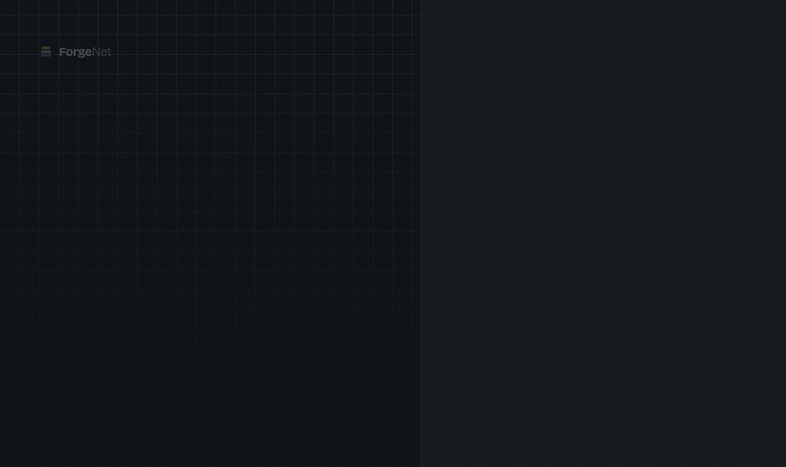

<div align="center">

# ForgeNet

**The sovereign, self-hosted cloud that never leaves your servers.**

Deploy, monitor and orchestrate your services — with a sysadmin AI that runs *locally*, without a single line of your logs ever reaching a third-party cloud.

[](LICENSE)
[](https://go.dev)
[](https://react.dev)
[](https://flutter.dev)
[](#-project-status)

**English** · [Français](README.md)

[Features](#-features) · [Install](#-installation) · [Comparison](#-why-not-coolify-or-dokploy) · [Architecture](#-architecture) · [Contributing](#-contributing) · [Support](#%EF%B8%8F-support-the-project)

</div>

---

## 🚧 Project status

> **Alpha — v0.1.0, first published release.** ForgeNet installs and is usable, but the API, the configuration and the data may still change between releases without a guaranteed migration. Try it on a test server, not in production yet.
>
> ⭐ Star the repo to follow along, or read the [roadmap](docs/ForgeNet_Document_de_Projet_v2.3.0.md#6-feuille-de-route--suivi-de-projet) (in French). Changes between releases are listed in the [CHANGELOG](CHANGELOG.md).

<p align="center">
  
</p>

**What v0.1.0 does**:

- **One-command install** on Debian or Ubuntu, x86_64 or ARM64: the server and Caddy in hardened containers, signed image (see [Installation](#-installation)).
- **Docker Compose deployments** from the dashboard: queued, followed live with their log, resumed when the server restarts; the real state of each stack, removal with or without its volumes.
- **Domains and HTTPS**: one domain per service, Let's Encrypt certificate and HTTPS redirect by Caddy, reloaded on every change.
- **Monitoring**: CPU, memory, disk and network for the server and each container, live, with the last hour; clean reconnection on a slow or dropped connection.
- **Containers**: list, inspect, start, stop, restart.
- **Accounts and security**: admin and member roles, permissions checked on every call, rate-limited sign-in, audit log.
- **API**: gRPC contract ([`api/proto`](api/proto)), also served over Connect and gRPC-Web, with generated TypeScript and Dart clients.

**Not there yet**: deployment rollback, deploy from Git, Marketplace, local AI assistant, backups, migration from other PaaS, CLI, and the mobile app, of which only the generated API client exists. The item-by-item status is in the [feature matrix](docs/ForgeNet_Matrice_Fonctionnelle_Complete_Dev.md) (in French); architecture decisions are in [`docs/decisions/`](docs/decisions/) (in French).

---

## The problem

Your production data — logs, metrics, secrets, databases — ends up on AWS, GCP or Azure. Your invoices are in dollars, your support desk is 5,000 km and six time zones away, and every "smart" diagnostic tool ships your logs off to a third-party API.

**ForgeNet starts from the opposite assumption: nothing leaves your servers.** Not the data, not the logs, not even the AI assistant's prompts. Installs on a VPS, bare metal, or a machine under your desk.

## ✨ Features

> This section describes **where ForgeNet is heading**. What v0.1.0 already does is listed under [Project status](#-project-status).

### The foundation
- **One-click deploys** — Docker, Docker Compose, or automatic buildpack detection (Node, Python, Go, PHP, Ruby, static). No Dockerfile required.
- **Push-to-deploy** — connect a GitHub/GitLab/Gitea repository; every push deploys the branch you configured.
- **Blue-Green & Canary** — progressive traffic shifting with automatic rollback when a health check fails. Zero downtime.
- **Automatic HTTPS** — Caddy issues and renews Let's Encrypt certificates without a byte of configuration.
- **1-click marketplace** — Postgres, MySQL, MongoDB, Redis, MinIO, plus an extensible community catalogue.
- **Real-time monitoring** — CPU, RAM, disk and network per host and per container, streamed over WebSocket.
- **Backups to self-hosted MinIO** — scheduled, checksum-verified, restorable in one click. No third-party object storage.

### What you won't find elsewhere

| | |
|---|---|
| 🧠 **100% local sysadmin AI** | An [Ollama](https://ollama.com)-powered assistant that analyses your logs, audits your security posture and suggests right-sizing — **with zero external API calls**. Your logs never leave the machine. Decisive in banking and government contexts. |
| 📶 **Built for low bandwidth** | Degraded mode with a local command queue, automatic replay when connectivity returns, differential sync and compressed streams. Designed for real-world networks, not for a well-connected European datacentre. |
| 📱 **Native mobile app (Flutter)** | Live monitoring, SSH terminal, push alerts and emergency restarts — behind biometric confirmation. The "3 a.m. incident" case, taken seriously. |
| 🔄 **Migrate from your current tools** | Automatic import of your Coolify, CapRover, Dokploy and Portainer projects. Switching takes minutes, not a weekend. |
| 🌍 **Local sovereignty and billing** | Data residency in the ECOWAS/OHADA region, billing in XOF (mobile money, card) or via PayPal, and French-language support. |

> The exhaustive list — 150+ features across 5 modules — lives in the **[feature matrix](docs/ForgeNet_Matrice_Fonctionnelle_Complete_Dev.md)** (in French).

## 🚀 Installation

On a Debian or Ubuntu server, as root:

<!-- x-release-please-start-version -->
```bash
curl -fsSLO https://raw.githubusercontent.com/forgelab-dev/lfa-forgenet/v0.2.0/deploy/install.sh
less install.sh   # read a script before running it as root
sudo bash install.sh --domain forgenet.example.org --email you@example.org
```
<!-- x-release-please-end -->

The script comes from the release tag: it installs the image of that same release, `ghcr.io/forgelab-dev/forgenet-server`, signed with cosign. How to verify it is described in [`docs/RELEASING.md`](docs/RELEASING.md) (in French).

It installs Docker if missing (official repository, verified key), writes `/opt/forgenet`, starts the server and Caddy, then creates the first administrator. It is safe to run again, for instance to add a domain or change version (`bash install.sh --help`).

**Without a domain**, the dashboard only listens on the server: open it through an SSH tunnel, `ssh -N -L 8080:127.0.0.1:8080 user@server`, then `http://localhost:8080`. The reasoning is in [ADR-0009](docs/decisions/0009-service-du-dashboard-en-production.md) (in French).

**Updating** — `sudo bash install.sh --update` moves to the latest published version: it backs up the database and configuration to `/opt/forgenet/sauvegardes/`, switches to the release's signed image, checks the server's health, and rolls back to the previous version automatically if anything fails. A version older than the installed one is refused. The design is in [ADR-0011](docs/decisions/0011-mise-a-jour-depuis-le-dashboard.md) (in French). From a 0.1.x release, which cannot update itself yet, the script takes the same backup and then reinstalls, without automatic rollback: if anything goes wrong, restore the backup.

**Restoring a backup** — `sudo bash install.sh --restore 20261114-150834-0.1.1` (the name of a folder in `/opt/forgenet/sauvegardes/`) puts back the database, `.env` and the install files, and therefore the version of that time, then restarts the server. Deployed sites keep running.

**Requirements** — Debian or Ubuntu, x86_64 or ARM64, 2 GB RAM, ports 80 and 443 free.

<details>
<summary>Manual install with Docker Compose</summary>

```bash
git clone https://github.com/forgelab-dev/lfa-forgenet.git
cd lfa-forgenet/deploy
cp .env.example .env && chmod 600 .env   # then fill it in
docker compose up -d
docker compose exec server forgenet-server user create --username admin --email you@example.org
```

</details>

## 🤔 Why not Coolify or Dokploy?

They are excellent tools — mature, free, and widely deployed. If you are in Europe or North America and AI-assisted diagnostics don't interest you, they will serve you well; we won't pretend otherwise.

ForgeNet exists for what they don't address:

| | ForgeNet | Coolify | Dokploy | CapRover |
|---|:---:|:---:|:---:|:---:|
| Free self-hosted, no limits | ✅ | ✅ | ✅ | ✅ |
| Automatic HTTPS | ✅ | ✅ | ✅ | ✅ |
| **100% local sysadmin AI** | ✅ | ❌ | ❌ | ❌ |
| **Native mobile app** | ✅ | ❌ | ❌ | ❌ |
| **Low-bandwidth / degraded mode** | ✅ | ❌ | ❌ | ❌ |
| **Import from other PaaS** | ✅ | ❌ | ❌ | ❌ |
| **XOF / mobile money billing** | ✅ | ❌ | ❌ | ❌ |
| French-language support | ✅ | ❌ | ❌ | ❌ |
| Blue-Green / Canary | ✅ | partial | partial | ❌ |

## 🏗 Architecture

| Component | Stack | Role |
|---|---|---|
| **Core Engine** | Go, gRPC, Connect | Docker orchestration, metrics (`gopsutil`), Caddy control, AI calls |
| **Web Dashboard** | React, Vite, Tailwind | Full administration: marketplace, logs, domains, databases |
| **Mobile App** | Flutter | Live supervision, push alerting, incident response |
| **AI Engine** | Ollama (Llama 3, Mistral, CodeLlama) | Log analysis, security audit, assistance — locally |
| **Reverse Proxy** | Caddy | Routing, automatic TLS, load balancing |

<details>
<summary>Repository layout (monorepo)</summary>

```
├── api/          # gRPC + OpenAPI contracts — source of truth, codegen Go/TS/Dart
├── cmd/          # Binaries: forgenet-server, forgenet-agent, forgenet-cli
├── internal/     # Go domain logic (orchestrator, proxy, metrics, ai, auth…)
├── pkg/          # Public Go SDK
├── web/          # React + Vite dashboard
├── mobile/       # Flutter application
├── templates/    # 1-click marketplace catalogue
├── deploy/       # install.sh, docker-compose, Caddyfile
└── docs/         # Specification, feature matrix, ADRs
```

</details>

## 🧑‍💻 Contributing

Contributions are welcome — code, marketplace templates, translations, documentation, or simply telling us how it went.

```bash
git clone https://github.com/forgelab-dev/lfa-forgenet.git
cd lfa-forgenet
task setup     # Go, Node and Flutter dependencies
task dev       # full local stack
task test      # test suite
```

**Conventions** — [Conventional Commits](https://www.conventionalcommits.org) (`feat:`, `fix:`, `chore:`), SemVer on the Core Engine, mandatory pull-request review before merging to `main`. Read [CONTRIBUTING.md](CONTRIBUTING.md) before your first PR.

Looking for a place to start? Issues labelled [`good first issue`](https://github.com/forgelab-dev/lfa-forgenet/labels/good%20first%20issue) are meant for exactly that.

> Project documentation is currently written in French. Contributions in English are welcome, and translating the docs is itself a valuable first contribution.

## 📦 Editions

ForgeNet follows an **open-core** model: the heart of the product is free and will stay that way.

| Edition | What you get | Price |
|---|---|---|
| **Community** | Deployments, monitoring, reverse proxy, local AI, backups — no container or server limits | Free, Apache 2.0 |
| **Enterprise** | SSO/SAML, multi-tenant & white-label, HA, secret rotation, compliance export | On request |
| **Managed Cloud** | ForgeNet hosted and operated by LucidForge Africa, billed in XOF | From ~5,000 XOF/month (≈ $8) |

No Community feature is ever removed or crippled to push you toward a paid edition.

## ❤️ Support the project

ForgeNet is built in West Africa on a modest budget. If it's useful to you:

- ⭐ **Star the repo** — free, and it's what makes us visible
- 💜 **[GitHub Sponsors](https://github.com/sponsors/forgelab-dev)** — monthly or one-time support, 0% platform fees
- 📱 **[Donate](https://don.lucidforgeafrica.com/forgenet)** — PayPal in US dollars for international supporters, or mobile money and card in XOF (FedaPay, KkiaPay)
- 🗣 **Spread the word** — a blog post, a tweet, a demo to your team

## 📄 License

[Apache 2.0](LICENSE) — © [LucidForge Africa](https://lucidforgeafrica.com)

<div align="center">
<sub>Built in West Africa 🌍 — because digital sovereignty shouldn't have to be imported.</sub>
</div>
