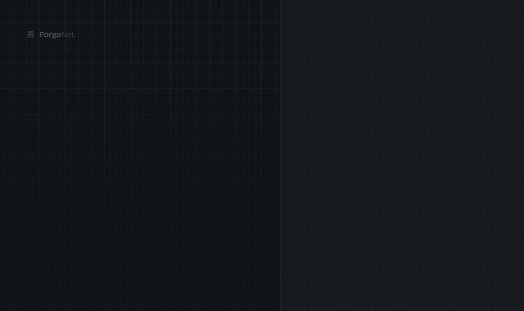

<div align="center">

<picture>
  <source media="(prefers-color-scheme: dark)" srcset="docs/media/logo/forgenet-symbole-fond-sombre.svg">
  
</picture>

# ForgeNet

**Le cloud souverain, self-hosted, qui ne quitte jamais vos serveurs.**

Déployez, surveillez et orchestrez vos services — avec une IA d'administration qui tourne *en local*, sans qu'une seule ligne de log ne parte vers un cloud tiers.

[](LICENSE)
[](https://go.dev)
[](https://react.dev)
[](https://flutter.dev)
[](#-état-du-projet) <!-- x-release-please-version -->

**Français** · [English](README.en.md)

[Fonctionnalités](#-fonctionnalités) · [Installation](#-installation) · [Comparatif](#-pourquoi-pas-coolify-ou-dokploy-) · [Architecture](#-architecture) · [Contribuer](#-contribuer) · [Soutenir](#-soutenir-le-projet)

</div>

---

## 🚧 État du projet

> **Alpha — v0.3.0.** <!-- x-release-please-version --> ForgeNet s'installe, se tient en main et se met à jour depuis son dashboard, mais l'API, la configuration et les données peuvent encore changer d'une version à l'autre sans migration garantie. Essayez-le sur un serveur de test, pas encore en production.
>
> ⭐ Mettez une étoile pour suivre l'avancement, ou consultez la [feuille de route](docs/ForgeNet_Document_de_Projet_v2.3.0.md#6-feuille-de-route--suivi-de-projet). Ce qui change d'une version à l'autre est dans le [CHANGELOG](CHANGELOG.md).

<p align="center">
  
</p>

**Ce que fait ForgeNet aujourd'hui** :

- **Installation en une commande** sur Debian ou Ubuntu, x86_64 ou ARM64 : le serveur et Caddy en conteneurs durcis, image signée (voir [Installation](#-installation)).
- **Déploiements Docker Compose** depuis le dashboard : mis en file, suivis en direct avec leur journal, repris au redémarrage du serveur ; état réel de chaque stack, suppression avec ou sans ses volumes.
- **Domaines et HTTPS** : un domaine par service, certificat Let's Encrypt et redirection HTTPS par Caddy, rechargé à chaque changement.
- **Surveillance** : processeur, mémoire, disque et réseau du serveur et de chaque conteneur, en direct, avec la dernière heure ; reconnexion propre sur une connexion lente ou coupée.
- **Conteneurs** : lister, consulter, démarrer, arrêter, redémarrer.
- **Mises à jour** : une nouvelle version est annoncée dans le dashboard et s'installe en un clic, avec sauvegarde de la base et de la configuration, contrôle de santé et retour automatique à la version précédente en cas d'échec ; `install.sh --restore` remet une sauvegarde.
- **Comptes et sécurité** : rôles administrateur et membre, droits vérifiés à chaque appel, tentatives de connexion limitées, journal d'audit.
- **API** : contrat gRPC ([`api/proto`](api/proto)), servi aussi en Connect et gRPC-Web, avec des clients générés en TypeScript et en Dart.

**Pas encore là** : retour arrière d'un déploiement, déploiement depuis Git, Marketplace, assistant IA local, sauvegardes des applications, migration depuis les autres PaaS, CLI, changement de mot de passe, envoi d'e-mails (invitations, mot de passe oublié), et l'application mobile, dont seul le client d'API généré existe. Le détail, case par case, est dans la [matrice fonctionnelle](docs/ForgeNet_Matrice_Fonctionnelle_Complete_Dev.md) ; les choix d'architecture dans [`docs/decisions/`](docs/decisions/).

---

## Le problème

Vos données de production — logs, métriques, secrets, bases — finissent chez AWS, GCP ou Azure. Vos factures sont en dollars, votre support est à 5 000 km et 6 heures de décalage, et le moindre outil de diagnostic « intelligent » envoie vos logs à une API tierce.

**ForgeNet part de l'hypothèse inverse : rien ne sort de vos serveurs.** Pas les données, pas les logs, pas les prompts de l'assistant IA. Installable sur un VPS, un serveur nu ou une machine de bureau.

## ✨ Fonctionnalités

> Cette section décrit **la cible** de ForgeNet. Ce qu'il fait déjà est listé dans l'[État du projet](#-état-du-projet).

### Le socle

- **Déploiement en un clic** — Docker, Docker Compose, ou détection automatique de buildpack (Node, Python, Go, PHP, Ruby, statique). Pas de Dockerfile requis.
- **Push-to-deploy** — connectez un dépôt GitHub/GitLab/Gitea, chaque push déclenche le déploiement de la branche configurée.
- **Blue-Green & Canary** — bascule de trafic progressive, rollback automatique si le health check échoue. Zéro downtime.
- **HTTPS automatique** — Caddy génère et renouvelle les certificats Let's Encrypt sans un octet de configuration.
- **Marketplace 1-click** — Postgres, MySQL, MongoDB, Redis, MinIO, et un catalogue communautaire extensible.
- **Monitoring temps réel** — CPU, RAM, disque, réseau par hôte et par conteneur, en streaming WebSocket.
- **Backups vers MinIO self-hosted** — planifiés, vérifiés par checksum, restaurables en un clic. Aucun stockage cloud tiers.

### Ce qui n'existe nulle part ailleurs

| | |
| --- | --- |
| 🧠 **IA sysadmin 100 % locale** | Un assistant propulsé par [Ollama](https://ollama.com) qui analyse vos logs, audite votre sécurité et suggère un right-sizing — **sans appel à une API externe**. Vos logs ne quittent jamais la machine. Décisif en contexte bancaire ou administratif. |
| 📶 **Conçu pour le bas débit** | Mode dégradé avec file d'attente locale, rejeu automatique au retour du réseau, synchronisation différentielle et flux compressés. Pensé pour une connectivité réelle, pas pour un datacenter européen. |
| 📱 **App mobile native (Flutter)** | Surveillance temps réel, terminal SSH, alertes push et redémarrage d'urgence — avec confirmation biométrique. Le cas « incident à 2 h du matin », traité sérieusement. |
| 🔄 **Migration depuis vos outils actuels** | Import automatique de vos projets Coolify, CapRover, Dokploy et Portainer. Basculer prend des minutes, pas un week-end. |
| 🌍 **Souveraineté et facturation locales** | Résidence des données en zone CEDEAO/OHADA, facturation en FCFA (Mobile Money, carte), support en français. |

> La liste exhaustive — 150+ fonctionnalités réparties sur 5 modules — est dans la **[matrice fonctionnelle](docs/ForgeNet_Matrice_Fonctionnelle_Complete_Dev.md)**.

## 🚀 Installation

Sur un serveur Debian ou Ubuntu, en root :

<!-- x-release-please-start-version -->
```bash
curl -fsSLO https://raw.githubusercontent.com/forgelab-dev/lfa-forgenet/v0.3.0/deploy/install.sh
less install.sh   # relisez un script avant de le lancer en root
sudo bash install.sh --domain forgenet.exemple.org --email vous@exemple.org
```
<!-- x-release-please-end -->

Le script vient du tag de la version : il installe l'image de cette même version, `ghcr.io/forgelab-dev/forgenet-server`, signée par cosign. Sa vérification est décrite dans [`docs/RELEASING.md`](docs/RELEASING.md#vérifier-une-image-publiée).

Le script installe Docker s'il manque (dépôt officiel, clé vérifiée), écrit `/opt/forgenet`, démarre le serveur et Caddy, puis crée le premier administrateur. Lancé sans terminal (cloud-init par exemple), il tire son mot de passe au hasard et le range dans `/opt/forgenet/admin-password`, lisible par root seul : gardez ce fichier, le changement de mot de passe n'existe pas encore ([#72](https://github.com/forgelab-dev/lfa-forgenet/issues/72)). Le script se relance sans risque, par exemple pour ajouter un domaine ou changer de version (`bash install.sh --help`).

**Sans domaine**, le dashboard n'écoute que sur le serveur : ouvrez-le par un tunnel SSH, `ssh -N -L 8080:127.0.0.1:8080 utilisateur@serveur`, puis `http://localhost:8080`. Les raisons de ce choix sont dans l'[ADR-0009](docs/decisions/0009-service-du-dashboard-en-production.md).

**Mise à jour** — une nouvelle version est annoncée aux administrateurs en haut du dashboard, et « Mettre à jour » l'installe. En terminal, `sudo bash install.sh --update` fait la même chose : sauvegarde de la base et de la configuration dans `/opt/forgenet/sauvegardes/`, bascule sur l'image signée de la release, contrôle de santé, et retour automatique à la version précédente en cas d'échec. Une version plus ancienne que celle en place est refusée. Le fonctionnement est décrit dans l'[ADR-0011](docs/decisions/0011-mise-a-jour-depuis-le-dashboard.md). Depuis une 0.1.x, qui ne sait pas encore se mettre à jour elle-même, le script fait la même sauvegarde puis réinstalle, sans retour automatique : en cas de souci, revenez à la sauvegarde.

**Revenir à une sauvegarde** — `sudo bash install.sh --restore 20261114-150834-0.1.1` (le nom d'un dossier de `/opt/forgenet/sauvegardes/`) remet la base, `.env` et les fichiers d'installation, donc la version d'alors, puis redémarre le serveur. Les sites déployés ne s'arrêtent pas.

**Redémarrage du serveur** — ForgeNet et Caddy repartent seuls, mais pas encore les applications dont le `docker-compose.yml` ne dit rien ([#70](https://github.com/forgelab-dev/lfa-forgenet/issues/70)) : en attendant, donnez `restart: unless-stopped` à leurs services.

**Prérequis** — Debian ou Ubuntu, x86_64 ou ARM64, 2 Go de RAM, ports 80 et 443 libres.

<details>
<summary>Installation manuelle avec Docker Compose</summary>

```bash
git clone https://github.com/forgelab-dev/lfa-forgenet.git
cd lfa-forgenet/deploy
cp .env.example .env && chmod 600 .env   # puis remplissez-le
docker compose up -d
docker compose exec server forgenet-server user create --username admin --email vous@exemple.org
```

</details>

## 🤔 Pourquoi pas Coolify ou Dokploy ?

Ce sont d'excellents outils, matures et gratuits. Si vous êtes en Europe ou en Amérique du Nord et que le diagnostic assisté par IA ne vous intéresse pas, ils répondront très bien à votre besoin — nous ne prétendons pas le contraire.

ForgeNet existe pour ce qu'ils ne traitent pas :

| | ForgeNet | Coolify | Dokploy | CapRover |
| --- | :---: | :---: | :---: | :---: |
| Self-hosted gratuit, sans limite | ✅ | ✅ | ✅ | ✅ |
| HTTPS automatique | ✅ | ✅ | ✅ | ✅ |
| **IA d'administration 100 % locale** | ✅ | ❌ | ❌ | ❌ |
| **App mobile native** | ✅ | ❌ | ❌ | ❌ |
| **Mode dégradé / bas débit** | ✅ | ❌ | ❌ | ❌ |
| **Import depuis les autres PaaS** | ✅ | ❌ | ❌ | ❌ |
| **Facturation FCFA / Mobile Money** | ✅ | ❌ | ❌ | ❌ |
| Support en français | ✅ | ❌ | ❌ | ❌ |
| Blue-Green / Canary | ✅ | partiel | partiel | ❌ |

## 🏗 Architecture

| Composant | Stack | Rôle |
| --- | --- | --- |
| **Core Engine** | Go, gRPC, Connect | Orchestration Docker, métriques (`gopsutil`), pilotage Caddy, appels IA |
| **Dashboard Web** | React, Vite, Tailwind | Administration complète : marketplace, logs, domaines, bases |
| **App Mobile** | Flutter | Supervision temps réel, alerting push, gestion de crise |
| **Moteur IA** | Ollama (Llama 3, Mistral, CodeLlama) | Analyse de logs, audit sécurité, assistance — en local |
| **Reverse Proxy** | Caddy | Routage, TLS automatique, load balancing |

<details>
<summary>Structure du dépôt (monorepo)</summary>

```
├── api/          # Contrats gRPC + OpenAPI — source de vérité, codegen Go/TS/Dart
├── cmd/          # Binaires : forgenet-server, forgenet-agent, forgenet-cli
├── internal/     # Cœur métier Go (orchestrator, proxy, metrics, ai, auth…)
├── pkg/          # SDK Go public
├── web/          # Dashboard React + Vite
├── mobile/       # Application Flutter
├── templates/    # Catalogue Marketplace 1-click
├── deploy/       # install.sh, docker-compose, Caddyfile
└── docs/         # Spécification, matrice fonctionnelle, ADRs
```

</details>

## 🧑‍💻 Contribuer

Les contributions sont bienvenues — code, templates de marketplace, traductions, documentation ou simple retour d'usage.

```bash
git clone https://github.com/forgelab-dev/lfa-forgenet.git
cd lfa-forgenet
task setup     # dépendances Go, Node et Flutter
task dev       # stack complète en local
task test      # suite de tests
```

**Conventions** — [Conventional Commits](https://www.conventionalcommits.org) (`feat:`, `fix:`, `chore:`), SemVer sur le Core Engine, revue par Pull Request obligatoire avant merge sur `main`. Consultez [CONTRIBUTING.md](CONTRIBUTING.md) avant votre première PR.

Vous cherchez par où commencer ? Les issues étiquetées [`good first issue`](https://github.com/forgelab-dev/lfa-forgenet/labels/good%20first%20issue) sont faites pour ça.

## 📦 Éditions

ForgeNet suit un modèle **open-core** : le cœur du produit est gratuit et le restera.

| Édition | Contenu | Prix |
| --- | --- | --- |
| **Community** | Déploiement, monitoring, reverse proxy, IA locale, backups — sans limite de conteneurs ni de serveurs | Gratuit, Apache 2.0 |
| **Enterprise** | SSO/SAML, multi-tenant & marque blanche, HA, rotation de secrets, export de conformité | Sur devis |
| **Managed Cloud** | ForgeNet hébergé et opéré par LucidForge Africa, facturé en FCFA | À partir de ~5 000 FCFA/mois |

Aucune fonctionnalité Community n'est retirée ou bridée pour pousser vers une édition payante.

## ❤️ Soutenir le projet

ForgeNet est développé en Afrique de l'Ouest avec des moyens modestes. Si le projet vous est utile :

- ⭐ **Mettez une étoile** — c'est gratuit et c'est ce qui nous rend visibles
- 💜 **[GitHub Sponsors](https://github.com/sponsors/forgelab-dev)** — soutien mensuel ou ponctuel, 0 % de frais de plateforme
- 📱 **[Faire un don](https://don.lucidforgeafrica.com/forgenet)** — Mobile Money ou carte en FCFA (FedaPay, KkiaPay), ou PayPal en dollars depuis l'international
- 🗣 **Parlez-en** — un article, un tweet, une démo à votre équipe

## 📄 Licence

[Apache 2.0](LICENSE) — © [LucidForge Africa](https://lucidforgeafrica.com)

<div align="center">
<sub>Construit en Afrique de l'Ouest 🌍 — parce que la souveraineté numérique ne devrait pas être un produit d'importation.</sub>
</div>
